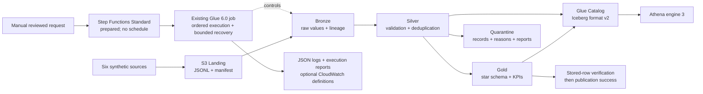

# Enterprise Delivery Operations Lakehouse — AWS

A working, synthetic last-mile delivery analytics platform built with Python, PySpark, Spark SQL,
S3, AWS Glue 6.0, Apache Iceberg v2, Glue Data Catalog and Athena. It demonstrates the engineering
behind trustworthy delivery metrics: reproducible inputs, auditable ingestion, explicit data quality,
repeatable publication, tested business formulas and tightly scoped deployment automation.

**Project status: COMPLETE — all three coding phases and the local technical audit are finished.**
The complete local suite passed **173 tests** (one live-AWS test intentionally skipped) with **91.92% coverage**;
[final `main` CI passed](https://github.com/chandrakanth02512-ctrl/aws-delivery-operations-lakehouse/actions/runs/40485752268).

**AWS status: PENDING — cloud deployment and managed-service execution have not been verified.**
AWS acceptance requires resolving the reported account authorization restriction and separate owner approval.
No AWS credentials, permanent access keys or paid workloads were created during implementation.
This repository contains only synthetic data, no real Amazon/customer data, and is not affiliated with Amazon.

## Business questions

- Which stations have the highest terminal delivery failure rate?
- How do weather, traffic and redelivery relate to lateness?
- How do driver workloads and first-attempt success rates vary?
- How many attempts does each shipment require, and why do attempts fail?
- Is on-time delivery improving across promised-delivery cohorts?

[Sample Athena queries](sql/athena/) answer these questions. Metrics have explicit denominators,
NULL behavior and boundary tests; failed attempts and failed shipments remain distinct.

The engineering problem is that repeated attempts, late confirmations, duplicates and incomplete
records can make operational reports disagree. This project preserves source evidence, validates
relationships, publishes a consistent dimensional model and recalculates affected historical groups
when new information arrives. Failed executions retain enough state to resume without double counting.

## Architecture



One Glue job supports snapshot and CDC modes through a shared execution runner. A prepared manual
Step Functions workflow starts that existing job and waits for its result; local execution uses the same
runner and transformations. The tests run real Iceberg writes and MERGE operations with a local JDBC catalog;
they do not require an AWS account. Prepared infrastructure targets the existing Sydney bucket;
its live account configuration remains unverified.

**Engineering choices worth reviewing:**

- Six relational contracts and seeded operational scenarios, including intentional defects.
- Content-addressed manifests, SHA-256 verification, immutable Landing and commit-last Bronze.
- Retention of every bad/duplicate record with its raw source, line identity and rejection reasons.
- ANSI-safe casts, enum/domain checks, parent integrity and cross-station assignment validation.
- Reconciled quality reports and a publication gate, including tested failure/retry behavior.
- Shipment and attempt facts, four dimensions and three daily KPI tables; joins avoid double counting.
- Snapshot replacement and incremental Iceberg MERGE, explicitly pinned to **format v2**.
- CDC ordering, retained delete tombstones, schema drift diagnostics and late historical corrections.
- Frozen publication plans, per-table recovery checkpoints and interrupted-commit failure tests.
- Ordered execution stages, deterministic execution IDs, explicit resume and bounded transient retries.
- Stored-row/schema verification before publication success, with execution reports and JSON diagnostics.
- Optional CloudWatch metrics/alarms; monitoring and alarm actions remain disabled by default.
- Documented cross-table publication limits; consumers must avoid reading during a batch.
- CloudFormation, exact-repository/main-branch OIDC trust, role separation, manual plan/apply workflow.
- Locked dependencies, SHA-pinned Actions, pinned JVM test artifacts, Pytest, Ruff and cfn-lint.

## Data and quality

Six seeded datasets model `delivery_stations`, `drivers`, `customers`, `shipments`,
`delivery_attempts` and `delivery_events`. The [data dictionary](docs/data-dictionary.md) documents
their keys, relationships, timestamps and business fields. Profiles include successful/late deliveries,
failures, redelivery, cancellation and deliberate duplicate, missing, invalid-status and orphan records.

Bronze preserves raw values with source/batch/ingestion lineage. Silver casts and validates types,
required fields, domains, relationships and source ordering; rejected records retain reasons in
quarantine. Gold organizes accepted data into four dimensions, two facts and three KPI aggregates. Per-dataset reconciliation and rejection thresholds gate publication.
See [layer design](docs/layers.md) for the exact contracts and handling rules.

## Run locally

Use Python 3.13, Java 17+ and `uv` **0.13.4 or later** (the workflows pin 0.13.4):

```bash
uv sync --frozen --extra spark
uv run python scripts/fetch_iceberg.py
BATCH_ID=$(uv run delivery-lakehouse generate --root data/operations)
uv run delivery-lakehouse-ops run-local --mode snapshot --root data/operations --batch-id "$BATCH_ID"
# Repeating the same command returns the completed publication without duplicate business rows.
uv run delivery-lakehouse-ops run-local --mode snapshot --root data/operations --batch-id "$BATCH_ID"
```

Or produce a compact, reproducible analytical summary:

```bash
uv run python scripts/demo.py
```

Outputs are under `data/`; the summary is `artifacts/demo-summary.json`. No AWS client is constructed
in local mode. The default small profile has **120 valid shipments**, plus deliberate duplicate and
invalid rows. Medium has 10,000 valid shipments; large has 100,000. Use `generate --profile medium`
only when you intentionally want more data. Settings are in [config/dev.json](config/dev.json).
Execution JSON, Markdown reports and verification results are under `data/operations/gold/_operations/`.
The original Phase 1/2 CLIs remain available; use a separate fresh root for each example.

## Example analytical results

The preserved [small synthetic snapshot evidence](docs/evidence/demo-summary.json), seed 42, contains
745 raw rows across six sources: 735 accepted and 10 quarantined. It produces 120 valid shipments:

| Measure | Local result | Meaning |
|---|---:|---|
| On-time delivery | 47.06% | 48 on-time / 102 delivered |
| Average delay | 279.32 minutes | Late minutes, including zero for on-time deliveries |
| First-attempt success | 77.78% | Successful first attempts / shipments with first-attempt evidence |
| Terminal delivery failure | 5.56% | 6 failed / (102 delivered + 6 failed) |

These are generated scenarios, not real operational findings or Amazon metrics. [Analytics guide](docs/analytics.md)
maps all nine business questions to Athena SQL, explains cancellation separately from failure, and
shows why rolling percentages must use additive counters. Queries are verified with local Spark;
the Athena engine and its metadata-table syntax remain pending live acceptance.

## Verify

**Final local regression: 173 passed, 1 intentionally skipped, zero failures in 931.17 seconds;
91.92% package line coverage (92% rounded).** The skipped test requires live AWS authorization. The suite includes
all Phase 1/2 tests, actual local Spark/Iceberg MERGE and recovery, Phase 3 execution control and SQL
analytics. [GitHub Actions](https://github.com/chandrakanth02512-ctrl/aws-delivery-operations-lakehouse/actions/workflows/ci.yml)
repeats these checks for pull requests and main; consult the check on the specific commit being reviewed.

```bash
uv run python scripts/fetch_iceberg.py
ICEBERG_SPARK_JAR=artifacts/iceberg-spark-runtime-4.1_2.13-1.11.0.jar \
  uv run pytest --cov=delivery_lakehouse --cov-report=term-missing
uv run ruff check .
uv run ruff format --check .
uv run cfn-lint infrastructure/*.yaml
uv run python scripts/data_dictionary.py --check
uv pip check
uv lock --check
uv build
uv run python scripts/package_glue.py
```

The [technical audit](docs/technical-audit.md) records the subsequent fixes, security review and
current verification. The [Phase 3 verification report](docs/phase3-verification.md) preserves its
original regression results and runtime limitations. [Phase 1](docs/verification.md) and
[Phase 2](docs/phase2-verification.md) evidence remain historical records. [Testing instructions](docs/testing.md)
distinguish local Spark/Iceberg tests, stubbed S3 tests and explicitly opted-in live AWS checks.

## CDC and late-arriving deliveries

```bash
uv run python scripts/fetch_iceberg.py
uv run python scripts/demo_cdc.py
```

This runs four deterministic batches through real local Iceberg tables. Shipment `SHCDC0001` starts
IN_TRANSIT, is reassigned from `DR0000` to `DR0003`, then receives a Wednesday confirmation of a
Monday delivery. Monday's fact and KPIs are corrected to show a 60-minute delay and two attempts.
Duplicate changes and an old batch replay do not duplicate records or rewind the checkpoint.
Before/after observations are written to `artifacts/cdc-demo-summary.json`.

CDC accepts full after-image INSERT/UPDATE and explicit DELETE operations. Per-record source versions
prevent stale overwrites, including after deletion. Parent deletes require explicit handling of their
dependents. Compatible nullable additions remain in raw JSON until an explicit typed-schema migration;
breaking changes are quarantined. Only affected facts, dimensions and KPI groups are merged.

See the [CDC architecture and example](docs/cdc-architecture.md) and
[local operation, adoption and recovery guide](docs/cdc-operations.md). There is no automatic DDL,
cross-table transaction, distributed writer lock or claim of large-volume performance certification.

## Orchestration, monitoring and recovery

The execution runner orders source validation, Bronze, Silver, Gold, publication, stored-row
verification and final success. It records timestamps, durations, row counts, quality metrics and
per-attempt failures. Completed execution IDs replay safely; failed/interrupted executions require
explicit resume. Retries default to off, with at most one in-process retry when explicitly configured
for recognized transient errors. Quality, schema and authorization failures do not automatically retry.

CDC recovery retains Phase 2's frozen plans and per-table checkpoints. Post-write verification checks
affected after-images and deleted keys before advancing success/checkpoints. **Iceberg commits are
atomic per table, not across tables**; readers must avoid concurrent publication. Single-writer
enforcement uses the shared local lock or the existing Glue job's concurrency-one limit.

The prepared [operations stack](infrastructure/operations.yaml) adds a manual Standard state machine
and optional monitoring. It is not deployed by CI, creates no schedule, defaults monitoring off and
keeps all alarm actions disabled. [Operations](docs/operations.md) and [monitoring](docs/monitoring.md)
describe execution identity, diagnostics, recovery and the later owner-reviewed setup.

A focused local benchmark showed event-only Gold planning drop from **nine Spark jobs to zero**, with
identical zero Gold output rows. This is a measured planning improvement, not an AWS or whole-pipeline
speedup claim. See [method, timings and remaining scan limits](docs/performance.md).

## Repository map

| Path | Responsibility |
|---|---|
| `src/delivery_lakehouse/contracts.py` | Source schemas and relationships |
| `src/delivery_lakehouse/generator.py` | Seeded data profiles and source manifests |
| `src/delivery_lakehouse/ingestion/` | Local/S3 storage boundary and Bronze ingestion |
| `src/delivery_lakehouse/transforms/` | Shared PySpark Silver and Spark SQL Gold logic |
| `src/delivery_lakehouse/quality/` | Reconciliation reports and quality gate |
| `src/delivery_lakehouse/pipeline.py` | Snapshot publication and retry behavior |
| `src/delivery_lakehouse/cdc/` | Change protocol, generation, immutable ingestion, incremental plans, MERGE and state |
| `src/delivery_lakehouse/operations/` | Execution control, retries, verification, metrics, reports and local/request CLI |
| `jobs/phase1.py` | Shared managed Glue entry point through execution control: snapshot default, optional CDC |
| `infrastructure/` | Owner-reviewed IAM bootstrap and repeatable resource definitions |
| `.github/workflows/` | Local CI and explicitly gated OIDC deployment |
| `tests/` | Unit, Spark, real local Iceberg and separate AWS tests |
| `sql/athena/` | Business and verification queries |
| `docs/` | Architecture, contracts, operations and recorded evidence |

## AWS deployment and cost

Region: **ap-southeast-2**. Existing bucket: **ck-delivery-ops-lakehouse-2026-1025**.
Prefixes: `landing/`, `bronze/`, `silver/`, `gold/`, `quarantine/`, `athena-results/`.

Start with the [IAM review and one-time setup guide](docs/deployment.md). Bootstrap is performed by
an owner using temporary credentials, then GitHub obtains short-lived credentials through OIDC.
Only this repository's approved `main` branch is trusted. There are no AWS access-key secrets.
Deployment workflows cannot start jobs or queries, and nothing is deployed automatically on push.

**Account blocker:** the owner reports an Organizations SCP denying OIDC-provider discovery.
AWS deployment remains paused pending resolution through AWS Support/the organization administrator.
Do not bypass that restriction or create IAM resources to work around it. Account credits and
service eligibility have not been independently verified by this audit.

Glue is pinned to **6.0, G.1X, two workers, 15-minute timeout, zero retries, concurrency one**.
There are no recurring schedules or continuously running workloads. A conservative planning estimate
is **$1–$4/month for ten small manual runs**, before credits; see [cost assumptions](docs/costs.md).
Manual orchestration adds a small per-transition cost; optional custom metrics/alarms cost extra if
enabled. The existing GitHub deployment role cannot create the separate operations IAM role/stack.
The existing $10 budget alert is not a hard spending limit. Never upgrade the Free Plan automatically.

## Design and roadmap

[Architecture and decisions](docs/architecture.md) · [Data dictionary](docs/data-dictionary.md) ·
[Layer design](docs/layers.md) · [KPI definitions](docs/kpis.md) ·
[Troubleshooting](docs/troubleshooting.md) · [File inventory](docs/file-inventory.md)
· [Phase 2 file inventory](docs/phase2-file-inventory.md)
· [Phase 3 file inventory](docs/phase3-file-inventory.md) · [Release checklist](docs/release-checklist.md)

| Phase | Scope | Status |
|---|---|---|
| 1 | Sources, lakehouse layers, quality, analytics, local verification, IaC and secure deployment preparation | Implemented; AWS acceptance pending approval |
| 2 | CDC, incremental MERGE, schema drift policy, late-arriving records, checkpoint/recovery | Implemented and locally verified; AWS acceptance pending |
| 3 | Execution control, recovery verification, prepared orchestration/monitoring, analytics, measured optimization and release workflow | Implemented; managed AWS acceptance pending |

This is a production-style portfolio implementation with explicit operational limits. It is not yet
a production-certified system: live IAM/Glue/Athena acceptance, multi-table reader coordination,
retention operations and larger-volume performance measurements remain outstanding.

Future work, not implemented: coordinated reader snapshots, reviewed retention/compaction,
larger-volume load tests and a reporting dashboard. Live AWS acceptance is the next validation step.
