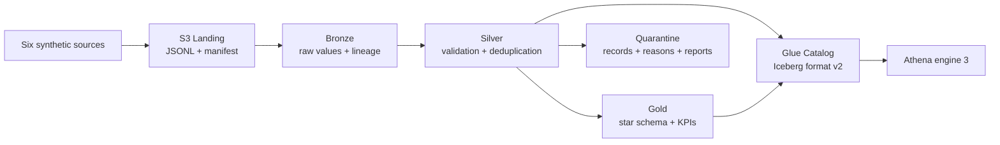

# Enterprise Delivery Operations Lakehouse — AWS

A working, synthetic last-mile delivery analytics platform built with Python, PySpark, Spark SQL,
S3, AWS Glue 6.0, Apache Iceberg v2, Glue Data Catalog and Athena. It demonstrates the engineering
behind trustworthy delivery metrics: reproducible inputs, auditable ingestion, explicit data quality,
repeatable publication, tested business formulas and tightly scoped deployment automation.

**Phase 1 is implemented and locally verified. AWS deployment and managed-service execution are
pending owner review and approval.** No AWS credentials, permanent access keys or paid workloads
were created. This repository contains no real Amazon/customer data and is not affiliated with Amazon.

## Business questions

- Which stations have the highest terminal delivery failure rate?
- How do weather, traffic and redelivery relate to lateness?
- How do driver workloads and first-attempt success rates vary?
- How many attempts does each shipment require, and why do attempts fail?
- Is on-time delivery improving across promised-delivery cohorts?

[Sample Athena queries](sql/athena/) answer these questions. Metrics have explicit denominators,
NULL behavior and boundary tests; failed attempts and failed shipments remain distinct.

## Architecture



One manually invoked Glue job runs the full snapshot pipeline. Local execution uses the same
transformations. The test suite also runs real Iceberg writes using a local JDBC catalog; it does
not require an AWS account. The existing Sydney bucket is reused without changing its security.

**Engineering choices worth reviewing:**

- Six relational contracts and seeded operational scenarios, including intentional defects.
- Content-addressed manifests, SHA-256 verification, immutable Landing and commit-last Bronze.
- Retention of every bad/duplicate record with its raw source, line identity and rejection reasons.
- ANSI-safe casts, enum/domain checks, parent integrity and cross-station assignment validation.
- Reconciled quality reports and a publication gate, including tested failure/retry behavior.
- Shipment and attempt facts, four dimensions and three daily KPI tables; joins avoid double counting.
- Atomic Iceberg table replacement, explicitly pinned to **format v2** for Athena compatibility.
- Documented cross-table publication limits; no claim of an atomic transaction across all 15 tables.
- CloudFormation, exact-repository/main-branch OIDC trust, role separation, manual plan/apply workflow.
- Locked dependencies, SHA-pinned Actions, pinned JVM test artifacts, Pytest, Ruff and cfn-lint.

## Run locally

Use Python 3.13, Java 17+ and `uv`:

```bash
uv sync --frozen --extra spark
BATCH_ID=$(uv run delivery-lakehouse generate)
uv run delivery-lakehouse run-local --batch-id "$BATCH_ID"
# Repeating the same command returns the completed publication without duplicate business rows.
uv run delivery-lakehouse run-local --batch-id "$BATCH_ID"
```

Or produce a compact, reproducible analytical summary:

```bash
uv run python scripts/demo.py
```

Outputs are under `data/`; the summary is `artifacts/demo-summary.json`. No AWS client is constructed
in local mode. The default small profile has **120 valid shipments**, plus deliberate duplicate and
invalid rows. Medium has 10,000 valid shipments; large has 100,000. Use `generate --profile medium`
only when you intentionally want more data. Settings are in [config/dev.json](config/dev.json).

## Verify

```bash
uv run python scripts/fetch_iceberg.py
ICEBERG_SPARK_JAR=artifacts/iceberg-spark-runtime-4.1_2.13-1.11.0.jar \
  uv run pytest --cov=delivery_lakehouse --cov-report=term-missing
uv run ruff check .
uv run ruff format --check .
uv run cfn-lint infrastructure/*.yaml
uv run python scripts/data_dictionary.py --check
uv pip check
```

The [Phase 1 verification report](docs/verification.md) records exact commands/results, runtime
versions, sample KPIs and what has **not** been tested. [Testing instructions](docs/testing.md)
distinguish local Spark/Iceberg tests, stubbed S3 tests and explicitly opted-in live AWS checks.

## Repository map

| Path | Responsibility |
|---|---|
| `src/delivery_lakehouse/contracts.py` | Source schemas and relationships |
| `src/delivery_lakehouse/generator.py` | Seeded data profiles and source manifests |
| `src/delivery_lakehouse/ingestion/` | Local/S3 storage boundary and Bronze ingestion |
| `src/delivery_lakehouse/transforms/` | Shared PySpark Silver and Spark SQL Gold logic |
| `src/delivery_lakehouse/quality/` | Reconciliation reports and quality gate |
| `src/delivery_lakehouse/pipeline.py` | Snapshot publication and retry behavior |
| `jobs/phase1.py` | Thin managed Glue entry point |
| `infrastructure/` | Owner-reviewed IAM bootstrap and repeatable resource definitions |
| `.github/workflows/` | Local CI and explicitly gated OIDC deployment |
| `tests/` | Unit, Spark, real local Iceberg and separate AWS tests |
| `sql/athena/` | Business and verification queries |
| `docs/` | Architecture, contracts, operations and recorded evidence |

## AWS deployment and cost

Region: **ap-southeast-2**. Existing bucket: **ck-delivery-ops-lakehouse-2026-1025**.
Prefixes: `landing/`, `bronze/`, `silver/`, `gold/`, `quarantine/`, `athena-results/`.

Start with the [IAM review and one-time setup guide](docs/deployment.md). Bootstrap is performed by
an owner using temporary credentials, then GitHub obtains short-lived credentials through OIDC.
Only this repository's approved `main` branch is trusted. There are no AWS access-key secrets.
Deployment workflows cannot start jobs or queries, and nothing is deployed automatically on push.

Glue is pinned to **6.0, G.1X, two workers, 15-minute timeout, zero retries, concurrency one**.
There are no recurring schedules or continuously running workloads. A conservative planning estimate
is **$1–$4/month for ten small manual runs**, before credits; see [cost assumptions](docs/costs.md).
The existing $10 budget alert is not a hard spending limit. Never upgrade the Free Plan automatically.

## Design and roadmap

[Architecture and decisions](docs/architecture.md) · [Data dictionary](docs/data-dictionary.md) ·
[Layer design](docs/layers.md) · [KPI definitions](docs/kpis.md) ·
[Troubleshooting](docs/troubleshooting.md) · [File inventory](docs/file-inventory.md)

| Phase | Scope | Status |
|---|---|---|
| 1 | Sources, lakehouse layers, quality, analytics, local verification, IaC and secure deployment preparation | Implemented; AWS acceptance pending approval |
| 2 | CDC, incremental processing, schema evolution, late-arriving records, deeper recovery | Not implemented |
| 3 | Orchestration, monitoring, performance tuning, production deployment automation, reporting | Not implemented |

This is a production-style portfolio implementation with explicit operational limits. It is not yet
a production-certified system: live IAM/Glue/Athena acceptance, multi-table reader coordination,
retention operations and larger-volume performance measurements remain outstanding.
