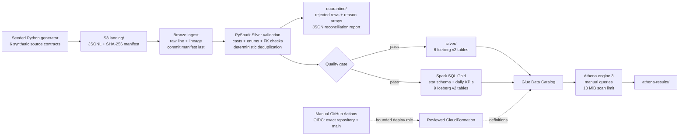
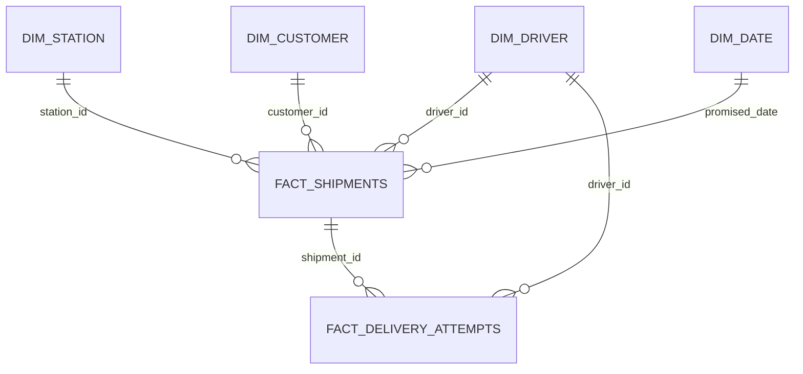

# Architecture and decisions

This document describes the preserved Phase 1 snapshot path. Phase 2 adds an incremental mode to
the same job: see [CDC architecture](cdc-architecture.md) for ordering, schema policy, MERGE,
delete semantics and recovery. CDC local mode uses persisted Iceberg tables, not Parquet-only output.

One manually started Glue 6.0 job executes all layers in order. Shared transformation modules also
run under ordinary local PySpark; the Glue entry point is a thin adapter. This avoids paying for
three separate Spark startups and avoids orchestration infrastructure in Phase 1.

Local mode uses filesystem Landing/Bronze and Parquet outputs. The integration suite additionally
runs the same pipeline against real Apache Iceberg 1.11.0 with a local H2 JDBC catalog and real
Parquet/metadata files. AWS uses GlueCatalog and S3FileIO supplied by Glue. The H2 dependency is
local-test-only; it is never uploaded to Glue.

- **Snapshot scope:** each manifest is a complete synthetic source snapshot. Silver and Gold replace
  the current contents, not append another copy. Different snapshot batches are not unioned. Source
  CDC, late data checkpoints and incremental merges are implemented in Phase 2. SCD2 is not implemented.
- **Identity:** canonical manifest hashes derive batch IDs; per-line identities distinguish repeated
  records. A changed payload creates a new batch, while reusing an ID with different bytes fails.
- **Storage:** existing bucket only. No crawler, additional bucket, VPC/NAT gateway, endpoint,
  development session, streaming engine or schedule. Job packages live under
  `landing/_artifacts/<git-sha>/`, outside batch directories. Reports live under `quarantine/`.
- **Iceberg compatibility:** create every curated table with `format-version=2`. Reject pre-existing
  tables reporting any other version. Do not upgrade a v2 table to v3: that is not reversible.
- **Publication:** each Iceberg table replacement is atomic. Publication across 15 tables is **not**
  atomic. `gold/_publication.json` moves RUNNING → SUCCEEDED or FAILED and includes the batch/run IDs.
  Analysts must wait for SUCCEEDED and avoid reading during a run. A failed publication can contain
  mixed table versions; rerun the same batch to converge. No concurrent local writers are supported;
  the one Glue job has a concurrency limit of one. Phase 3 can add coordinated consumer publication.
- **Replay:** source and committed Bronze hashes are checked even on a no-op. The pipeline run hash
  includes source batch, package version, DQ threshold, catalog and database prefix. Bump the package
  version for transformation changes. A successful same-run replay returns the prior publication.
  The no-op trusts the curated publication record; manual deletion/mutation requires operator repair.
- **Scale:** small defaults to 120 shipments, medium 10,000, large 100,000. Python generation holds
  one snapshot in memory; Bronze handles one entity at a time. This is a bounded portfolio source
  generator, not a high-volume production ingestion service. Distributed ETL has no Python UDFs,
  avoids collecting business rows on the driver, and aggregates attempts before joining facts.
- **Partition choice:** tiny curated tables are deliberately unpartitioned, preventing thousands of
  tiny partitions. Parquet compression and a 128 MiB target file size are set. The initial job uses
  eight shuffle partitions; partitioning/compaction benchmarks belong to Phase 3.

The design follows the current [Glue runtime documentation](https://docs.aws.amazon.com/glue/latest/dg/release-notes.html)
and [Glue 6.0 migration guidance](https://docs.aws.amazon.com/glue/latest/dg/migrating-version-60.html).
Glue 6.0 is Spark 4.1.1, Python 3.13 and Java 17; local patch versions and AWS-specific libraries can differ.
[Athena's Iceberg restrictions](https://docs.aws.amazon.com/athena/latest/ug/querying-iceberg.html)
remain a separate live validation requirement.
