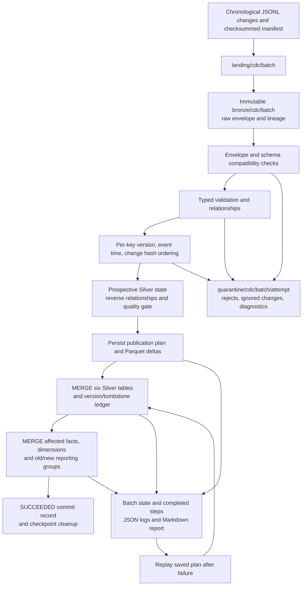

# Phase 2: incremental delivery operations

Phase 2 extends the snapshot pipeline with explicit CDC batches. It reuses the six source contracts,
quality rules, KPI formulas, S3 bucket, Glue job, Catalog databases and existing IAM permissions.
The implementation uses ordinary Python functions and real Spark SQL `MERGE INTO` statements.
Local verification uses Spark 4.1.1 and Iceberg 1.11.0 with an H2 JDBC catalog. AWS acceptance is pending.

## Source protocol and ordering

Each JSONL line contains exactly these envelope fields. Manifest protocol version is 2; the CDC
implementation protocol is 1. These are separate from **Iceberg table format version 2**.

| Field | Contract |
|---|---|
| `dataset` | One of the six source contract names |
| `record_id` | Non-empty source primary key without outer whitespace; must match the after-image key |
| `operation` | `INSERT`, `UPDATE` or `DELETE` |
| `source_version` | Positive signed 64-bit integer; monotonic per dataset/key |
| `source_event_at` | Offset-aware timestamp, normalized to UTC |
| `change_id` | SHA-256 of canonical envelope content excluding batch ID and change ID |
| `batch_id` | SHA-256 identity of the batch; must match its manifest |
| `data` | Full after-image for INSERT/UPDATE; JSON null for DELETE |

INSERT and UPDATE are after-image upserts. UPDATE can arrive before INSERT, and a newer INSERT can
restore a deleted key. Reported inserted/updated counts describe the actual target state, regardless
of the source operation label. Partial patches are not supported. DELETE of an already absent key
still advances its tombstone, but `rows_deleted` is zero because no current business row was removed.

For each dataset/key, valid candidates are ordered by the tuple
`(source_version, source_event_at in UTC, change_id lexicographically)`. The greatest tuple wins.
The hash is an arbitrary but repeatable tie-breaker for conflicting equal-version/equal-time changes.
Source versions take precedence over timestamps. Validation happens before winner selection, so an
invalid version 99 cannot hide a valid version 2. Invalid changes never advance the version ledger.

The `cdc_record_state` Iceberg table stores `dataset`, `record_key`, `source_version` (BIGINT),
`source_event_at` (TIMESTAMP), `change_id`, `is_deleted` (BOOLEAN), and `batch_id`. Its composite key is
`(dataset, record_key)`; the remaining fields except those noted are strings. It retains deleted keys
as tombstones. No expiry is implemented: removing tombstones would allow stale inserts to resurrect
deleted records. An ordered MERGE independently guards ledger updates during recovery.

`source_event_watermark` is the maximum accepted source event time across successful batches. It is
an **observability checkpoint, not a filtering threshold**. A new key or higher version with an older
event time is still processed. Business dates come from shipment `promised_at`, not arrival time or
the watermark. A timestamp anomaly can therefore affect the displayed watermark without excluding
later legitimate late events. Source clocks and version resets need an explicit upstream correction.
Watermarks are collected from Spark as offset-bearing strings, preserving microseconds without
depending on the Python driver's host timezone.

## Immutable Bronze and traceability

Landing manifests declare dataset schemas, expected filenames, SHA-256 hashes and row counts. Files
are uploaded first, the manifest last. Bronze checks every source before writing. It preserves the
raw CDC envelope with ingestion time, source filename, source line, batch ID, raw hash and line ID.
A write-once ingestion header preserves the first timestamp when an interrupted ingest resumes.
The Bronze commit manifest is written last and is itself checksummed. Replays verify both source
and committed Bronze content; a changed manifest cannot reuse an existing batch identity.

The storage adapters use atomic filesystem replacement or conditional S3 writes for immutable
objects. Application code never overwrites committed Bronze. This is application immutability,
not S3 Object Lock. Source and Bronze objects must be retained for replay; deleting Landing makes
even an otherwise successful replay fail integrity verification.

## Quality and schema evolution policy

Silver retains the Phase 1 schemas, safe casts, enum/domain checks, foreign keys, station relationships
and event/attempt consistency rules. Two snapshot-specific attempt rules are relaxed in CDC:
historical attempts retain their actual driver after reassignment, and failed attempts can precede
an IN_TRANSIT or CANCELLED current shipment. Successful attempt evidence must still agree with the
shipment's delivered state/time. Attempt numbers are unique within a shipment.

| Source change | Classification | Behavior |
|---|---|---|
| New declared nullable scalar column | Compatible | Retain in raw Bronze/Silver JSON; do not add a typed curated column |
| Removed optional column | Compatible | Materialize known optional field as null |
| Removed required column | Breaking | Quarantine changes for that dataset |
| Added non-nullable column | Breaking | Quarantine; explicit migration required |
| Renamed column (removal plus addition) | Breaking | Report possible rename; do not guess a mapping |
| Declared type or nullability change | Breaking | Report expected/observed definition and quarantine |
| Undeclared payload field or wrong JSON value type | Invalid record | Quarantine with field-specific reason |

The manifest is a declaration, not proof: payload wire types and required fields are independently
checked. Duplicate JSON keys and non-standard NaN/Infinity constants are rejected. No automatic
production DDL occurs. A migration needs reviewed contract/transformation changes, table schema
migration or backfill, version updates and regression tests. Existing target schemas and locations
are checked before use; incompatible schemas and Iceberg v3 are refused.

Rejected rows retain the complete raw envelope and reason array. Duplicate, replayed, stale and
superseded changes are retained in a separate `ignored` audit dataset, not counted as invalid data.
Every dataset reconciles `input = accepted changes + rejected + ignored`. Each attempt writes
`quality.json`; integrity failures also write the invalid prospective rows and `integrity.json`.
The default rejection ceiling remains 15% per nonempty dataset, and all-rejected input always fails.
Quality-approved batches can publish valid rows while retaining rejects. Correct rejected records
in a **new batch**; replaying a successful batch is a no-op and will not reconsider its rejects.

## Delete semantics and analytical history

Deletes are physical removals from current Silver and Gold business tables, with durable ordering
tombstones. There is no implicit cascade. A shipment with remaining attempts/events cannot be
deleted. Supply explicit dependent deletes in the same batch. Dimension deletes likewise require
all remaining references to be deleted or reassigned. Updating a parent's station can also invalidate
existing children; the final prospective relationship check fails before any business table is merged.

Current facts and affected historical KPIs are restated after an accepted delete. Empty KPI groups
and date dimension rows are removed. Dimensions use current-state semantics, not SCD2. Old Iceberg
snapshots may retain former rows until an explicitly reviewed retention process removes them; this
is not a privacy-erasure workflow. Immutable Bronze remains the source audit trail. Queries that
need an immutable historical reporting series would require a separately designed reporting model.

## Incremental Gold strategy

1. Collect changed shipment keys, plus the old and new shipment owners of changed/deleted attempts.
2. Rebuild only those shipment facts, aggregating their current attempts before joining to avoid fan-out.
3. Identify their **old and new promised dates, stations and assigned drivers**.
4. Read the complete fact population for affected dates, substitute changed facts and recompute additive
   KPI numerators/denominators. MERGE only the affected day/station and day/driver groups.
5. MERGE changed source dimensions and attempt facts; explicitly delete keys no longer present.

Unchanged facts retain their original lineage. A driver-name-only update touches its dimension;
event-only arrivals do not rewrite shipment facts/KPIs. Shipment after-images are authoritative:
a DELIVERED event alone does not invent a shipment status update. The synthetic late confirmation
batch includes the shipment update and attempt/event evidence together.

[KPI formulas](kpis.md) are shared with Phase 1. On-time percentage divides by delivered shipments;
first-attempt success divides by shipments with attempt-number-1 evidence; terminal failure divides
by delivered plus failed shipments. Zero denominators yield NULL. Driver shipment KPIs use the
current assigned driver; `fact_delivery_attempts.driver_id` records who actually made each attempt.

This avoids full **publication/rebuilding** of unchanged tables. It does not claim every operation is
O(delta): reference validation scans prospective relationships, affected-date aggregation scans all
members of those cohorts, and unpartitioned tiny Iceberg tables can rewrite shared data files. JSON
source decoding is bounded, driver-side work intended for portfolio profiles. Partition pruning,
distributed ingestion and measured large-volume tuning remain future work. Phase 3's measured
event-only optimization and remaining limits are recorded in [performance](performance.md).

## State, publication and recovery

| Location | Purpose |
|---|---|
| `gold/_cdc/initialized.json` | Catalog/database binding and explicit Phase 1 baseline adoption |
| `gold/_cdc/checkpoint.json` | Active writer batch, last succeeded batch, source event watermark |
| `gold/_cdc/batches/<batch>.json` | PENDING → RUNNING → SUCCEEDED/FAILED, attempts/history, counts, errors, step checkpoints |
| `gold/_cdc/reports/<batch>.md` | Human-readable execution and quality report |
| `gold/_cdc/plans/<batch>/attempt-N/` | Frozen Parquet deltas plus checksummed publication manifest |
| `quarantine/cdc/<batch>/attempt-N/` | Rejected/ignored envelopes, integrity rows and JSON reports |
| `gold/_publication.json` | Shared snapshot/CDC reader publication gate |

The entire plan is staged before business-table publication. Its manifest binds source checksum,
package/protocol versions, catalog, database and rejection policy. Recovery checks the manifest,
staged schemas and row counts, then uses that same plan instead of recalculating from partially
updated tables. Parquet files are written with `errorifexists`; the manifest checksum protects plan
metadata, not a cryptographic digest of every Parquet byte. Treat this internal staging area as
pipeline-owned and never edit it manually.

Each committed table step is checkpointed. An interruption after MERGE but before its checkpoint
causes that exact delta to be applied again; primary-key MERGE and fixed after-images converge.
Completed steps are skipped. Publication/watermark records are prepared only after all steps pass;
the persisted SUCCEEDED batch state is the authoritative commit record. A later retry cleans up an
active checkpoint left by a crash. Replaying an older successful batch never rewinds global state.
A failed final success-record write is treated as a failed publication, preserving the prior committed
watermark and the recovery plan. A failed validation with no plan may be superseded by a corrected
new batch. A partial publication blocks other batches until the active batch is recovered.

Iceberg commits are atomic **per table**, not across the six Silver tables, ledger and nine Gold
tables or S3 state objects. Readers must wait for SUCCEEDED and avoid overlapping publication;
checking a marker alone cannot lock an Athena query against a subsequent writer. There is no
multi-table snapshot transaction or distributed writer lock. Use the one Glue job at concurrency 1;
the local CLI takes a filesystem lock. Direct function callers must serialize their writes as well.
Do not run another job/process against the same tables. External table edits and manual state deletion
are unsupported and need operator-led repair, not blind replay.

## Practical late-delivery example

The four deterministic batches contain this shipment, plus baseline operational data:

| Arrival | Shipment SHCDC0001 after processing | Driver | Version | Gold result |
|---|---|---|---:|---|
| Saturday 7 February 2026 | IN_TRANSIT, promised Monday 9 February 07:00 UTC | DR0000 | 1 | One pending shipment, no delivery denominator |
| Tuesday 10 February | IN_TRANSIT, reassignment event dated Sunday | DR0003 | 2 | Move shipment workload from old to new driver group |
| Wednesday 11 February | DELIVERED, actual Monday 9 February 08:00 UTC | DR0003 | 3 | Restate Monday: 60-minute delay, two attempts, first attempt failed |

The Wednesday arrival is older than the previous global watermark (a Tuesday deletion), yet it is
accepted because version 3 is newer. Monday's cohort has two shipments (the other is CANCELLED):
one delivered, zero on-time, two attempts, 0% first-attempt success, 60-minute average delay, and
0% terminal failure. The cancelled shipment contributes to total shipments but not terminal ratios.
The full small sequence ends with 121 shipments: 120 baseline + two new − one explicit deletion.

See [operations](cdc-operations.md) for runnable commands and [verification](phase2-verification.md)
for actual results, failure coverage and remaining AWS acceptance work.
