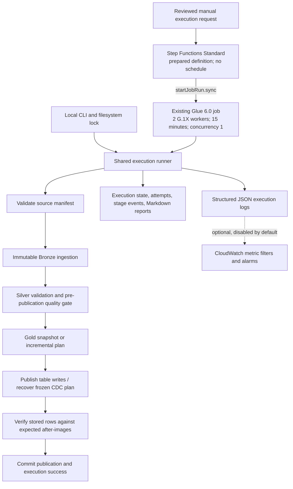

# Phase 3 execution control and recovery

Phase 3 wraps the existing snapshot/CDC runners. It does not replace their transformations, ordering
ledger, immutable Bronze, Iceberg v2 MERGE or frozen publication plans. The AWS definition is prepared
only; **no AWS resources, jobs, queries or alerts were activated during implementation**.

## Execution architecture



One Glue job executes the ordered data stages, avoiding a Spark startup for each layer. The outer
state machine validates request fields, waits for the Glue job to finish, captures failures and reports
success only when the job returns. It creates no Glue jobs, buckets, schedules, SNS subscriptions or
Lambda functions. The existing job's worker/timeout/retry/concurrency configuration is unchanged.
Its JSONPath guard checks presence, nonempty batch string, mode and retry bounds; the request builder
and Glue adapter enforce the complete 64-character hexadecimal batch ID contract. Use generated
requests: manually supplied malformed hashes can reach job startup before the adapter rejects them.

The shared runner records SOURCE → BRONZE → SILVER → GOLD → PUBLISH → VERIFY → COMMIT. Silver's
existing quality gate remains **before writes**; the additional verification happens **after writes
but before success markers**. A recovered CDC plan skips recalculating Silver/Gold and reuses its
saved deltas. A completed batch emits REPLAY and performs no new business publication.

## Request, execution and retry identity

`execution_request()` validates batch ID, mode, catalog, adoption flag and retry bounds. Its canonical
hash includes package version, database, bucket/region and quality/retry parameters. The default
execution name is `ops-<request-sha256>`. A name accepts only 1–80 letters, digits, underscores or
hyphens. Reusing an execution ID with different parameters fails before processing.

Execution records live under `gold/_operations/executions/<execution-id>.json`. They contain the
request/hash, PENDING/RUNNING/SUCCEEDED/FAILED status, timestamps, attempt history, stage events,
metrics, verification result and underlying publication reference. Human-readable reports live under
`gold/_operations/reports/`; verification reports under `gold/_operations/verification/`.

A successful execution replay validates immutable source/Bronze integrity, returns the existing
execution record and does not emit another completion metric. A different execution name for an
already committed source batch returns a business no-op with zero newly processed/output rows.
`source_rows` still describes its original source. A retry after a lost execution commit record retains
the original logical execution's applied counts when the underlying pipeline has already committed.

Standard Step Functions supplies a second boundary: a deterministic execution name with the same
input is idempotent while running; closed names cannot be reused for 90 days. Explicitly redrive a
failed eligible execution, or deliberately choose a new reviewed name for recovery. The definition
passes `resume_execution=true` so an explicit redrive can resume its persisted execution state.
It has **no Task Retry block** that blindly starts another Glue job after an ambiguous failure.

The job runner defaults to **one attempt**, meaning no automatic retries. An explicit `max_attempts=2`
allows one additional in-process attempt after recognized transient storage/connection errors. Delay
is configurable from 0–30 seconds. Source/contract errors, quality failures, permission errors,
conflicting active batches and unclassified JVM failures are never automatically retried. Glue's
own `MaxRetries` remains zero. Retries share the same job's 15-minute timeout; they do not extend it.
The attempt limit is per invocation; explicit manual resume/redrive starts another bounded invocation.

Every attempt retains its start/end, duration, exception type/message, category and retryability.
Execution `duration_seconds` describes the latest invocation, while `started_at` retains the first
invocation's start and the attempt history preserves earlier durations. Manual pauses are not presented
as processing time. A killed process can leave RUNNING state: it is not evidence of success.

## Verification and publication semantics

Snapshot verification compares each of the 15 stored tables against its expected DataFrame, including
schema and multiset equality. CDC verification reads the frozen plan and compares the stored rows
for each affected key against its after-image. Deleted keys must be absent; duplicates, missing rows,
changed values and incompatible schemas fail verification. Newly created empty tables must be empty.
Unchanged tables/keys are outside CDC post-verification; Silver still performs its existing full
prospective relationship validation before publication.

Verification reports state the scope (`full_snapshot` or `changed_keys`) and tables/rows checked.
CDC verification failures retain the same publication plan and prior committed watermark. A transient
verification/storage failure can retry without rebuilding from partially published state. A genuine
row mismatch is a data quality failure and requires investigation; the runner does not silently
rewrite externally corrupted tables or bypass completed-step checkpoints.

Iceberg commits remain atomic **per table only**. Neither Step Functions nor a JSON success marker
makes multiple table commits atomic. Readers must avoid overlapping writes and check the publication
gate. The local CLI shares the Phase 2 filesystem lock; the existing Glue job enforces concurrency one.
Direct Python callers and other job definitions must also serialize writes. There is no distributed
multi-writer lease. Manual catalog/table/state edits are outside normal replay guarantees.

## Run locally

Python 3.13, Java 17+ and a POSIX filesystem are required for the local commands:

```bash
uv sync --frozen --extra spark
uv run python scripts/fetch_iceberg.py
BATCH_ID=$(uv run delivery-lakehouse generate --root data/operations)
uv run delivery-lakehouse-ops run-local --mode snapshot --root data/operations \
  --batch-id "$BATCH_ID" --execution-id snapshot-demo
# Exact execution replay; no duplicate publication or completion metric.
uv run delivery-lakehouse-ops run-local --mode snapshot --root data/operations \
  --batch-id "$BATCH_ID" --execution-id snapshot-demo
```

For CDC, generate the Phase 2 sequence into a **separate fresh root**, then invoke the operations CLI
once for each manifest in order:

```bash
uv run delivery-lakehouse-cdc generate --root data/operations-cdc > /tmp/operations-cdc-batches.json
uv run python -c 'import json; print("\n".join(b["batch_id"] for b in json.load(open("/tmp/operations-cdc-batches.json"))))' > /tmp/operations-cdc-ids.txt
while IFS= read -r batch_id; do
  uv run delivery-lakehouse-ops run-local --root data/operations-cdc --batch-id "$batch_id" || break
done < /tmp/operations-cdc-ids.txt
```

The prior Phase 1 and Phase 2 CLIs remain available. Snapshot adoption still requires
`--adopt-phase1-snapshot`; see [CDC operations](cdc-operations.md). Do not overwrite a CDC-initialized
root with a snapshot. Source generation/upload is separate from execution; the runner ingests the
manifest's already prepared source files and never invents or uploads a source batch implicitly.

## Recovery runbook

1. Read the execution report, failing attempt and `current_stage`. Also inspect the underlying CDC
   batch state, `checkpoint.json`, publication marker and quarantine.
2. Fix transient storage access or restore the exact missing source bytes. Do not change immutable
   batch content. Correct rejected business records/schema in a new source batch.
3. For a failed/RUNNING local execution, explicitly rerun the same request/ID with `--resume`.
   A request with changed parameters needs a new ID. Do not delete its execution record to bypass
   duplicate prevention.
4. If a CDC publication plan exists, recover that active batch before another batch. Preserve source,
   staged deltas, ledger/tombstones and per-table checkpoints. Retain the original package version
   and rejection policy. Finish pending Phase 2 plans with their original release before upgrading.
5. Confirm post-verification and both publication/execution success, then release readers. For a
   post-verification row mismatch, stop and investigate external writes or an implementation defect;
   no automatic destructive repair is provided.

Example explicit local resume, retaining the exact original parameters:

```bash
uv run delivery-lakehouse-ops run-local --root data/operations-cdc \
  --batch-id REPLACE_WITH_BATCH_ID --execution-id REPLACE_WITH_EXECUTION_ID --resume
```

The `failure_hook` and injected sleeper/verifier used by tests are Python test seams, not CLI flags
or cloud failure switches. They exercise real committed-merge recovery without provisioning AWS.

## Prepared cloud request and later deployment

This command produces JSON only and never constructs an AWS client:

```bash
uv run delivery-lakehouse-ops plan-aws --batch-id REPLACE_WITH_BATCH_ID \
  > /tmp/reviewed-delivery-execution.json
```

After separate approval, the owner first deploys the reviewed 0.3.0 job/ZIP release using the existing
main-stack procedure. Review `infrastructure/operations.yaml` as a separate named-IAM change set,
stack name `delivery-ops-operations`, region Sydney, `EnableMonitoring=false`. The existing GitHub/CFN
deployment roles intentionally cannot create this new role/state machine; the owner must perform
that reviewed one-time setup using a temporary authorized session. No existing IAM policy is broadened
by this phase. The new role can start/read/stop **only** `delivery-ops-dev-phase1`; it cannot read S3,
execute Athena, modify IAM or launch arbitrary jobs.

The owner/operator needs separately reviewed StartExecution/DescribeExecution/GetExecutionHistory
permissions, and RedriveExecution/StopExecution only if authorized. Paste the generated `input` into
the Step Functions console and use its generated `name` only after compute approval and source upload.
Confirm the job points at the 0.3.0 release; older adapters do not provide Phase 3 verification.
Do not add a schedule. Cloud acceptance and IAM simulation remain unperformed.

For a later approved stop, inspect the Glue JobRun as well as the state machine; `.sync` cancellation
is best-effort and does not roll back table commits. Before cleanup, stop active work and recover or
document incomplete publication. Delete only reviewed project resources; preserve the shared bucket
and unrelated data. See [monitoring](monitoring.md), [release checklist](release-checklist.md) and
[verification](phase3-verification.md).
